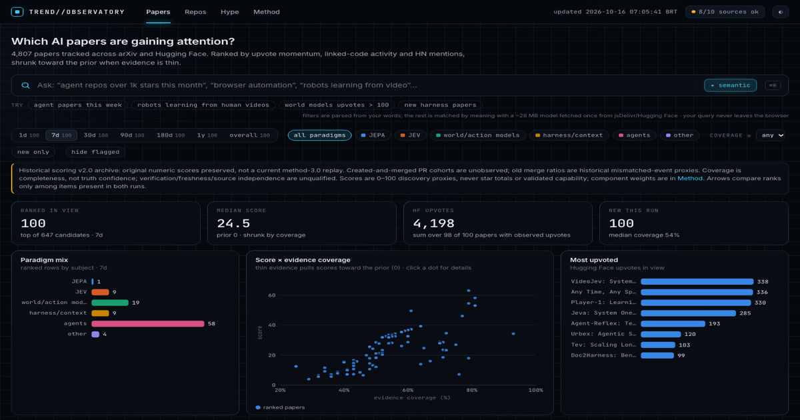

# dehype

[](LICENSE)
[](https://creativecommons.org/licenses/by-sa/4.0/)

**dehype** is a daily AI reality briefing: what happened in AI in the last 24 hours, what each story's evidence is and who has confirmed what, in English and Portuguese, on a record anyone can verify. It grew out of `trending-research` (the repository's earlier name), whose tracker still ranks **papers** and **GitHub repos** on AI agents, harnesses and context layers, JEPA, JEV (decision models), and world and action models, and compares sampled **Attention** with **Discovery** proxies across AI projects. Scores and stories are leads for investigation; they do not establish capability, adoption, economic value or truth.



How it fits together, in plain diagrams: [docs/ARCHITECTURE.md](docs/ARCHITECTURE.md). Current sequencing and decisions: [docs/ROADMAP.md](docs/ROADMAP.md). Launch plan (2026-10-16; its Cloudflare and licence lines are superseded, see [ROADMAP.md](docs/ROADMAP.md#superseded-statements)): [docs/PUBLISHING.md](docs/PUBLISHING.md).

## Research and roadmap state

This repository is also an open research experiment in autonomous delivery: comparing models and harnesses while they work on real tasks. The fixed **100-hour diagnostic window is 2026-10-10 18:19 UTC–2026-10-14 22:19 UTC**, not a proven goal-activation interval or 100 hours of active compute/coding. See [research experiment and telemetry](docs/research-experiment.md) for dated measurements, reconciliation and comparison limits.

The **2026-10-15 measured research checkpoint** confirms 2,429 stored records from a parent-only historical prefix and a bounded live cohort, including automatically discovered documentation-worker activity. Instrumentation is private; this repository publishes sanitized methods and results, not deployable instrumentation or raw telemetry. The new bridge is **stopped/disabled under an explicit human maintenance hold**: production rollback/restore and resumed suffix delivery remain unverified. Automatic capture stopped around **19:35 UTC on October 15**; later activity is outside these verified cohorts and subsequent eligible-suffix growth is unknown. Stored history is not continuous current delivery, whole-harness spend or a model-efficiency ranking.

The [observatory roadmap](.genie/wishes/open-intelligence-observatory/WISH.md) is **in progress**, with [tracking issue #1](https://github.com/namastex888/trending-research/issues/1), 20 child issues (#2–#21), five milestones, 80 original criteria and 41 dependencies. Six issues (#2, #3, #5, #6, #8 and #11) have historical local acceptance for their original and quality gates; 14 remain unaccepted, and none of the five milestone exits is accepted. Local acceptance does not make the whole observatory complete or a public product release.

Roadmap work through 2026-10-16 was aggregated in [PR #22](https://github.com/namastex888/trending-research/pull/22), now merged. The default branch is `dev`; changes land through pull requests against it. The rebased comparison baseline is `aa932ad3c29af7f5a67c3060344af97bc8d87c75`; the [continuation runbook](.genie/wishes/open-intelligence-observatory/checkpoints/2026-10-14/CONTINUE.md), [checkpoint](.genie/wishes/open-intelligence-observatory/checkpoints/2026-10-14/checkpoint.json) and [rebase record](.genie/wishes/open-intelligence-observatory/checkpoints/2026-10-14/REBASE.md) explain the earlier handoff and remaining gates.

## Quickstart

```bash
git clone https://github.com/namastex888/dehype && cd dehype
python -m http.server 8765 -d web   # open http://localhost:8765 to browse the committed snapshot
```

`web/` is a set of static pages (`index.html`, `stories.html`, `output.html`, `hype.html`, `method.html`, `audit.html`, sharing `dehype.css` and `dehype.js`) that read committed data files, so any static host can serve the snapshot offline; no page has a build step. To check the current scoring code against bundled fixtures without refreshing data, run `python eval.py --features tests/fixtures/features_a.json tests/fixtures/features_b.json --hype tests/fixtures/hype_small.json`.

An optional network refresh is `python run.py`; it calls external source APIs and is separate from browsing or fixture evaluation. Install [requirements.txt](requirements.txt) first if needed (`tzdata` on Windows); `gh auth login` or a `GH_TOKEN` variable raises GitHub API limits.

**Live site:** https://namastex888.github.io/dehype/

**Hosting and updates.** GitHub Pages is the only host (no Cloudflare, no server). `.github/workflows/refresh.yml` runs daily in GitHub Actions, scheduled at 04:45 America/Sao_Paulo so the briefing is live by 06:00: it fetches and scores (`run.py`), builds the conversation map and the briefing (`pulse.py`), composes the four feeds (`scripts/dehype/compose.mjs`, Cordis 4.0.4), writes the day's ledger entry and story-id archive (`scripts/manifest.py`), puts the input manifest on a dated GitHub Release, commits only the bot-written files to `dev` and deploys `web/` through `deploy.yml`. `ci.yml` runs on every pull request; `scripts/check_page.mjs` is the page and public-data gate, and it also checks that the refresh stages exactly the bot-written files. Until the owner applies the pending workflow change (`.genie/wishes/dehype-s1/f-workflow.proposed.diff`, after `e-workflow.combined.proposed.diff`), the cron still runs at 06:17 and the ledger steps are not wired. Details: [ARCHITECTURE.md](docs/ARCHITECTURE.md).

## The pages

| Page | What it shows | Data it reads |
|---|---|---|
| **Briefing** (`index.html`) | the gauge header (at most four gauges, each a preview with its coverage) and the day's Top 10 stories, each with its evidence record and verdict state | `briefing.json`, `pulse.json`, `verdicts.json` |
| **Stories** (`stories.html`) | every story of the last 7 days, with its posts as counts or handle-free links | `briefing.json`, `pulse.json` |
| **Output** (`output.html`) | releases and research output by area: Papers and Repos, with search by words or by meaning | `data.json`, search index |
| **Hype** (`hype.html`) | sampled attention against discovery proxies for AI projects, from a research dossier with a content cut | `hype.json` |
| **Method** (`method.html`) | [METHODOLOGY.md](METHODOLOGY.md) and [METHODOLOGY.pt.md](METHODOLOGY.pt.md), the policy, and the licence | the method sources |
| **Audit** (`audit.html`) | the ledger, the dated Releases, attestations, timestamp proofs, verdicts, corrections and removals | `ledger/index.json` |

Every page exists in English and Portuguese. Old console URLs (`#pulse`, `#papers`, `#repos`, `#hype`, `#methodology`, `?q=`, `?open=`) fold to their dehype page. Search by meaning embeds the query in the browser with a small open model; transformers.js 4.2.0 (exact-pinned) and its onnxruntime wasm build load from jsDelivr and the model weights from Hugging Face, only after the reader selects it (vendoring it is deferred: GitHub push protection flags a pattern in the minified bundle; needs an owner decision). Feeds: `feed.xml` and `feed.json` (and `.pt`), RSS 2.0 and JSON Feed 1.1.

## Method in one minute (current scoring v3.0)

1. **Normalize** each signal against the whole run's distribution: `u = min(1, log1p(v) / log1p(P95))`. One outlier can't squash the rest, and a small window can't inflate its few items.
2. **Combine** present compatible signals with fixed weights. **Evidence coverage** is the weighted share observed, with discounts for rate proxies; usage families stay outside the HYPE discovery composite.
3. **Anti-noise**: star spikes without matching issue, PR or commit activity are capped. Solo repos, one-off spikes, single-post and single-platform attention are discounted.
4. **Shrink** GitHub and Papers scores toward their reference median: `score = prior + coverage * (raw - prior)`. HYPE Attention and Discovery instead shrink within their own percentile cohorts toward 50.
5. **Momentum** uses real deltas between our own snapshots, blended with the since-release rate while history is shorter than the window. With no snapshot it falls back to per-day-since-release rates, marked `~` (rate proxy).
6. **Gap** = Attention − Discovery: a difference between percentiles from different proxy cohorts. Labels describe which proxy is ahead only when both coverage values reach 50%; they are not capability or economic verdicts.
7. **Arrows** compare ranks only among items present in both runs, with hysteresis, so small changes don't flip them.

The committed `web/data.json` paper and GitHub numbers are a **historical v2 numeric archive**, with original scores and generation clocks preserved and coverage labels clarified. They have not been rescored as v3. The HYPE view uses v3 Attention and Discovery projections, while some linked activity inputs remain historical v2. All weights and thresholds are in [scoring_config.json](scoring_config.json), and the code is [scoring.py](scoring.py). Full details, including known biases: [METHODOLOGY.md](METHODOLOGY.md).

## Data coverage

- Sources: arXiv API, Hugging Face papers API, Hacker News (Algolia), GitHub REST API. HYPE also uses a social-research dossier: a purposive, public-only sample of X, Reddit, LinkedIn, HN, YouTube, Discord and Telegram posts. HN dominates it (about 2,019 of 2,163 sampled posts), and it is not committed.
- Reddit, X and LinkedIn have no free API in the pipeline. The GitHub stargazer-timestamp endpoint returned HTTP 404 in our runs, so star growth comes from our own snapshots, which are young until runs accumulate.
- HYPE counts are **samples**, not platform-wide totals. Acceleration can't be measured yet (no growth series). Downloads count operations, not unique users.
- **Numbers are never invented.** Missing data shows as — and reduces evidence coverage when applicable. Every source failure is listed under "Data sources" on the page.

## Repository layout

```
run.py               fetch -> features -> score -> web/data.json (+ history/, cache/: not committed)
hype_build.py        HYPE tab: research dossier -> web/hype.json
scoring.py           current v3 scoring plus frozen historical v2 mode
scoring_config.json  every weight and threshold
eval.py              stability / evidence / HYPE-shortlist report for scoring PRs
pulse.py             conversation map, stories and the daily briefing -> web/pulse.json, web/briefing.json
scripts/             page gate (check_page.mjs), Cordis composition (dehype/), ledger (manifest.py, ots.mjs), search index (embed/)
METHODOLOGY.md       the method, with METHODOLOGY.pt.md (run.py and deploy.yml copy both to web/ for the method page)
web/                 static pages and data snapshots (CC BY-SA 4.0)
tests/               unit tests + a small real-data fixture
```

## Contributing

Weight changes, new data sources, seed queries and bug reports are welcome. Read [CONTRIBUTING.md](CONTRIBUTING.md). In short: edit the config, run `python eval.py`, paste its output into the PR, and never invent a number.

## Citation

If you use the tracker, its method or its data, please cite it ([CITATION.cff](CITATION.cff)):

```bibtex
@software{rosa_dehype_2026,
  author  = {Rosa, Felipe and {Namastex}},
  title   = {dehype: a daily AI reality briefing and evidence-weighted tracker of AI research papers, repositories and hype},
  year    = {2026},
  url     = {https://github.com/namastex888/dehype}
}
```

## License

Copyright (C) 2026 Felipe Rosa / Namastex.

From the commit that replaced the MIT `LICENSE` with the GNU Affero General Public License, version 3 or (at your option) any later version (`git log --follow -- LICENSE` names it):

- **Code**: [AGPL-3.0](LICENSE).
- **Data** (`web/*.json`, the feeds, `web/ledger/` and the dated Release assets): [CC BY-SA 4.0](https://creativecommons.org/licenses/by-sa/4.0/), covering only our selection, arrangement and computed fields. Post titles, headlines, names, links and other third-party text keep their owners' terms, and each upstream source keeps its own.
- **Earlier releases keep their licence**: every commit before that one, the 2.0 release of 2026-10-07 included, stays under MIT for code and CC BY 4.0 for data.
- Third-party code keeps its own notice: `scripts/dehype/NOTICE` (Cordis, MIT), `scripts/checks/NOTICE` (OpenTimestamps client, LGPL-3.0); transformers.js (Apache-2.0) loads from its own package in the browser.

The full statement is in the method's [Licence](METHODOLOGY.md#licence) section.
